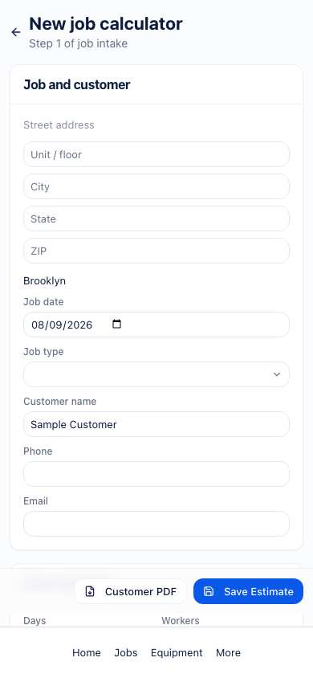

# Urgent estimate and invoice fixes — 8 September 2026

The mobile calculator actions sit above the app navigation. The save action reads “Save estimate,” and the page title matches the navigation label, “Job Calculator.” Customer PDF previews offer file sharing; unsupported browsers download the file and explain how to attach it. Cancelling the share sheet does nothing further.

Invoice photo grids use at most 12 photos per page. Both invoice and estimate PDFs exclude internal job instructions while retaining document notes and line-description overflow.

## Verification

- Full Vitest suite after resolving against current `main`: 1,117 passed, 5 skipped.
- TypeScript, the focused changed-file lint, and the production build pass.
- Repository-wide lint still reports the current `main` baseline debt: 131 errors and 150 warnings in unrelated files.
- Added tests inspect generated invoice and estimate PDF text, exercise native-share success/cancellation/failure/unsupported paths, and check pagination for 13–40 photos.
- Screenshots below use the actual React components and generated application CSS with a local fixture context at 390 × 844. The calculator capture includes a simulated 64px navigation bar. The PDF capture isolates the action header; the native dialog portal is replaced for static rendering. These are layout checks, not live-account or physical-device end-to-end tests.
- No live database changes or messages were sent. Native device share-sheet delivery still needs a physical-device check.

The screenshots predate the conflict resolution and remain evidence for the original mobile geometry. Current behavior is covered by the merged calculator tests and the focused share/pagination tests.
